## Datos Secuenciales {.smaller}


::: {.callout-note}
Hasta ahora, hemos asumido que los datos con los que trabajamos son independientes e idénticamente distribuidos (i.i.d). Sin embargo, en muchos casos, los datos tienen una estructura secuencial que debe ser considerada al momento de modelarlos. Algunos ejemplos comunes de datos secuenciales incluyen:
:::

::: {.columns}
::: {.column}

#### Time Series (precios de acciones, datos meteorológicos, etc)
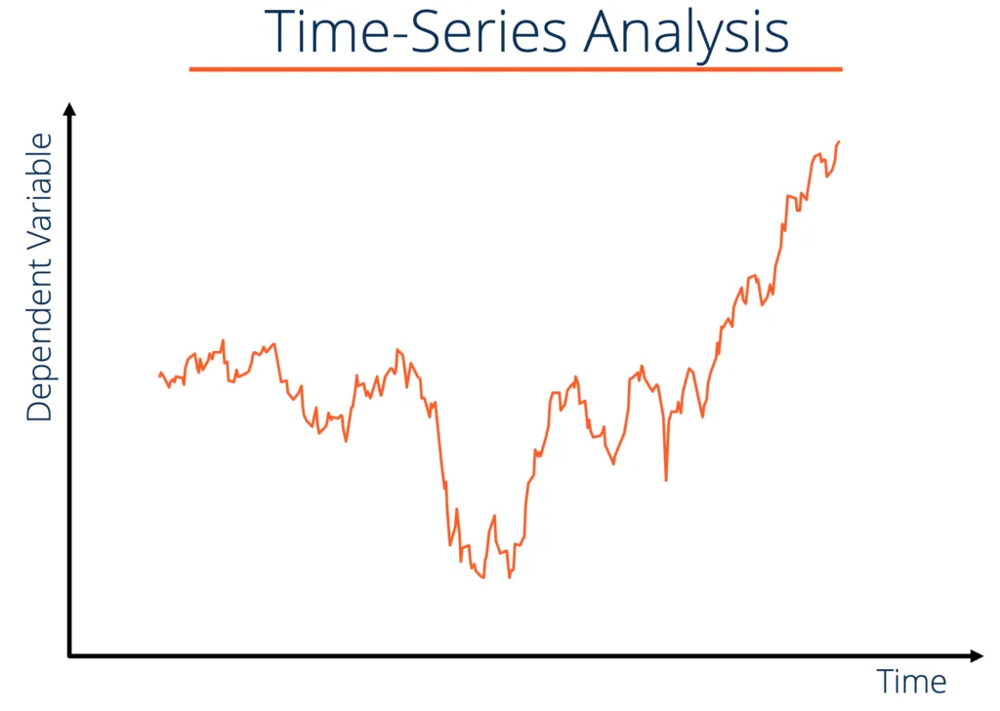{.lightbox fig-align="center" width="50%"} 

#### Audio (grabaciones de voz, música, etc)
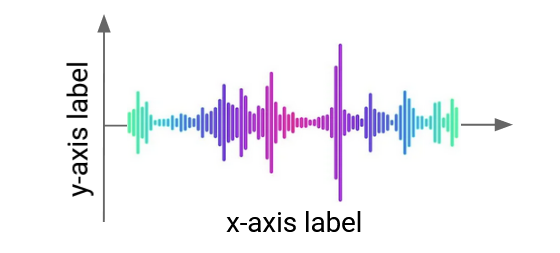{.lightbox fig-align="center" width="70%"} 
:::
::: {.column}
#### Texto (oraciones, documentos, etc)
{.lightbox fig-align="center" width="70%"} 

#### Genoma (secuencias de ADN, etc.)
{.lightbox fig-align="center" width="50%"} 
:::
::: 

## Datos Secuenciales {.smaller}

> También pudiesen existir datos "multimodales", donde por ejemplo, se combinan secuencias con imágenes.

::: {.columns}
::: {.column}
#### Image Time Series
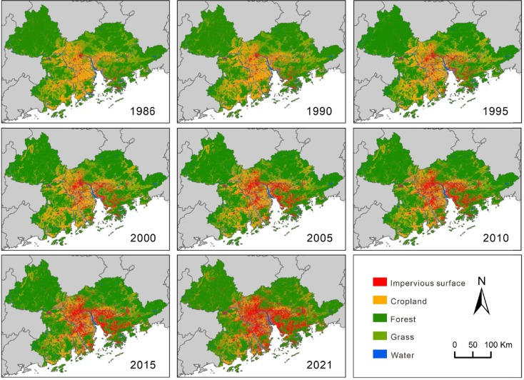{.lightbox fig-align="center"} 
:::
::: {.column}
#### Video

{.lightbox fig-align="center"} 
:::
::: 

## ¿Cómo se ven datos secuenciales reales? {.smaller}

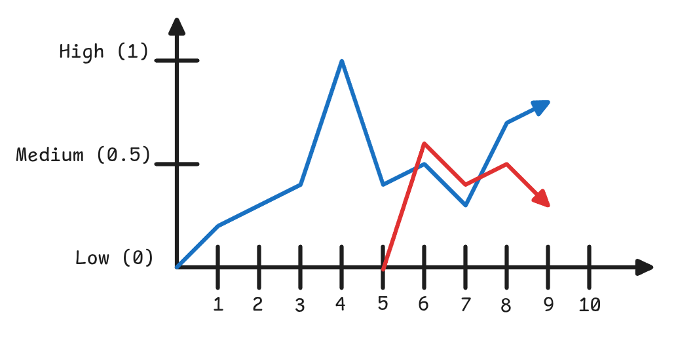{.lightbox fig-align="center" width="50%"} 

:::{.callout-note appearance="default" icon="false"}
## Supongamos el siguiente ejemplo: 

* Buscamos predecir el porcentaje de retorno de la inversión en función de los retornos obtenidos en días anteriores.
* En este ejemplo, la acción “Azul” cuenta con un historial de 10 días, mientras que la acción “Roja” dispone únicamente de 5 días de historial.
:::

:::{.callout-warning appearance="default" icon="false"}
## Nos gustaría poder entrenar un modelo capaz de trabajar con datos de entrada de distintas longitudes (secuencias de tamaño variable).
:::

:::{.callout-important appearance="default" icon="false"}
## Queremos que el modelo sea capaz de utilizar información pasada para realizar predicciones sobre valores futuros.
:::

## Redes Neuronales Recurrentes (RNNs) {.smaller}

RNN
: Corresponden a un tipo de red neuronal diseñada para procesar secuencias de datos manteniendo en memoria los inputs previos. A diferencia de los otros tipos de redes que procesan datos de manera independiente, acá existen conexiones cíclicas que permiten retener información en el tiempo.

:::: {.columns}
::: {.column}
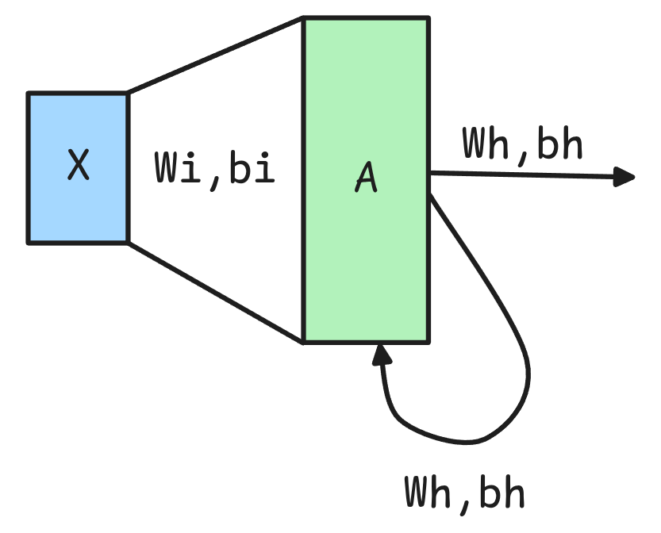{.lightbox fig-align="center"} 
:::
::: {.column}
$$h_t = f(x_t \cdot W_{ih}^T + b_{ih} + h_{t-1} \cdot W_{hh}^T + b_{hh})$$

::: {.callout-caution}
## En la implementación original $f$ corresponde a la $tanh(\cdot)$.
:::

:::
::: 

## Recurrent Neural Networks {.smaller}

::: {.columns}
::: {.column}
::: {.callout-tip icon="false" appearance="default"}
## Pros
* Pueden tomar secuencias de distinto tamaño (Largo) como predictores de un problema.
* Toman como antecedentes los puntos pasados como referencia para las predicciones futuras.
:::
:::
::: {.column}

::: {.callout-important icon="false" appearance="default"}
## Cons
* Se van complicando a medida que las secuencias son cada vez más largas.
* Vanishing/Exploding Gradients Problem.
:::
:::
::: 

::: {.callout-warning appearance="default"}
## Nomenclatura
* A las salidas de una RNN se les suele llamar Hidden State ($h_t$) o Estado Oculto. Este representa la memoria de la red en el tiempo $t$.
:::
::: {.callout-caution appearance="default" icon="false"}
## 🚨 Una RNN tiene dos set de parámetros: $W_{ih}$ y $b_{ih}$, los cuales representan la transformación entre los valores de entrada y el estado oculto, y $W_{hh}$ y $b_{hh}$ los que representan la transformación entre el estado oculto previo y el actual (Feedback Loop).
:::

::: {.callout-note appearance="default" icon=false}
## 👀 Es importante mencionar que las RNN son aplicadas a la secuencia elemento a elemento. 
:::

## Implementación Básica de una RNN {.smaller}

```{.python}
rnn = nn.RNN(input_size=1, hidden_size=2, num_layers=1, batch_first=True)

def forward_pass_rnn(x):
    N, L, D = x.shape 
    h=[0]
    for seq_id in range(L):
        h.append(torch.tanh(x[:,seq_id,:]*rnn.weight_ih_l0 + rnn.bias_ih_l0 + h[-1]*rnn.weight_hh_l0 + rnn.bias_hh_l0))
    return h
```
<br>

::: {.columns}
::: {.column}
```{.python}
# Una secuencia de (3,1)
x1 = torch.tensor([[[2.],
                    [7.],
                    [6.]]])
forward_pass_rnn(x1)
```
```
tensor([[0.4727, 0.1731]],
        [[ 0.9106, -0.9335]],
        [[ 0.7067, -0.9780]])

Shape: (1,3,2)
```
:::
::: {.column}
```{.python}
# Una secuencia de (2,1)
x2 = torch.tensor([[[4.],
                    [6.]]]))
forward_pass_rnn(x2)
```
```
tensor([[ 0.6634, -0.4728]]),
        [[ 0.7876, -0.9505]])

Shape: (1,2,2)
```
:::
::: 

::: {.callout-important appearance="default" icon="false"}
## 🚨 Básicamente la RNN genera una transformación affine por cada time step $t$ agregando información de su ***memoria pasada***. Es decir, cada elemento de la secuencia es transformado y llevado a un número de dimensiones igual a `hidden_size`.
:::

## Unrolling RNN {.smaller}


::: {.columns}
::: {.column width="70%"}
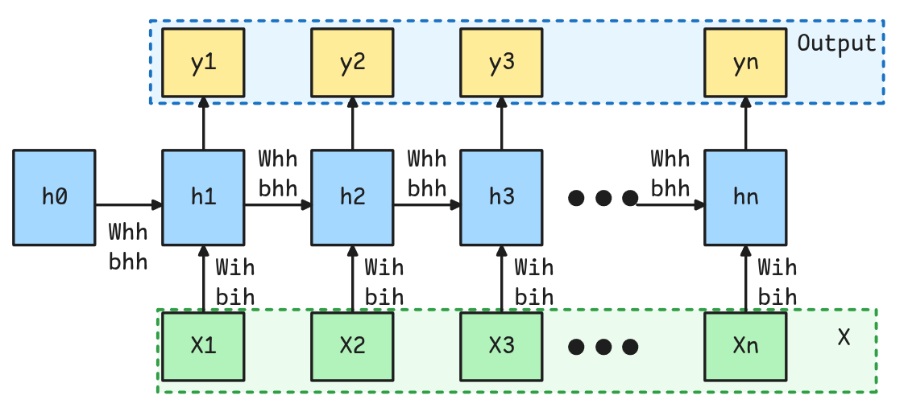{.lightbox fig-align="center"} 
:::
::: {.column width="30%"}
::: {.callout-note appearance="default" icon="false"}
## ☝️ Nomenclatura en Pytorch
* El output $y_t$ tiene al mismo valor que $h_{t+1}$. Se utiliza nomenclatura distinta para diferenciar de una salida directa a un valor que será utilizado como input en el siguiente time step.
* $h_0$ corresponde al hidden state inicial y tiene por defecto un vector de ceros.
* $W_{ih}$ y $b_{ih}$ son los parámetros que proyectan la entrada $x_t$ al hidden size. Mientras que $W_{hh}$ y $b_{hh}$ son los parámetros que proyectan el hidden state previo $h_{t-1}$ al hidden state actual.
:::

:::
::: 

:::{.callout-tip appearance="default" icon="false"}
## 📢 Unrolling de una RNN
El unrolling consiste en representar una RNN como una secuencia virtual de capas conectadas que permite ver la relación entre los elementos de cada time step. Es importante notar que los parámetros se comparten, es decir, cada una de las capas tiene los mismos pesos y bias.
:::


## Vanishing/Exploding Gradients {.smaller}

::: {.callout-warning}
* Entre más larga se la secuencia (más unrolls se realicen), más difícil es entrenar la red debido a dos posibles problemas: el `vanishing gradient problem` y el `exploding gradient problem`.
:::


::: {.columns}
::: {.column}
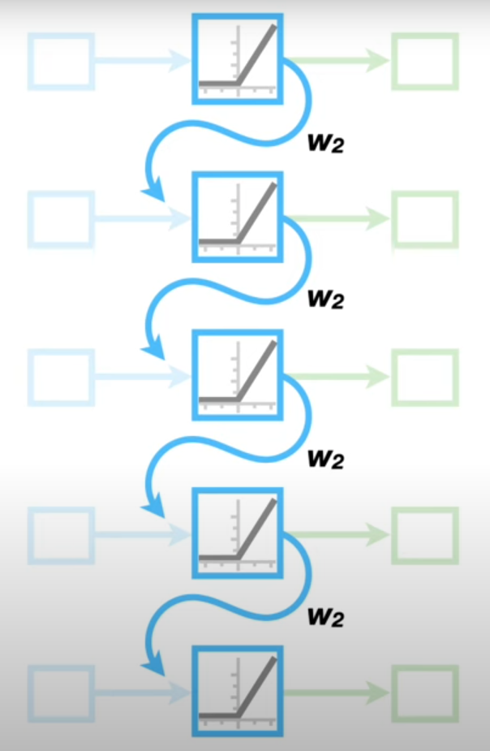{.lightbox fig-align="center" width="60%"} 
:::
::: {.column}
$$Gradiente = f(Input \times W_2^{N_{Unroll}})$$

* Cuando los valores de $W_2$ son muy pequeños (menores que 1), el gradiente tiende a desvanecerse (vanishing gradient). 

* En cambio, si los valores de $W_2$ son muy grandes (mayores que 1), el gradiente tiende a explotar (exploding gradient).

::: {.callout-caution}
$W_2^{N_{Unroll}}$ aparece en la ecuación al momento de comenzar a derivar de manera recursiva. 
:::
::: {.callout-important}
Las `Vanilla RNNs` se utilizan muy poco en la práctica; sin embargo, tienen una relevancia histórica significativa, ya que sentaron las bases para el desarrollo de arquitecturas más avanzadas, como las LSTMs y los Transformers.
:::
:::
::: 

## Tipos de Tareas a Resolver en Datos Secuenciales {.smaller}

::: {.columns}
::: {.column}
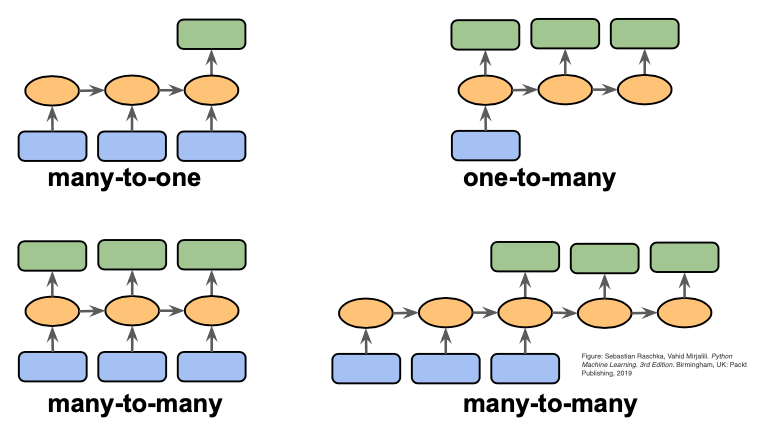{.lightbox fig-align="center" }
:::
::: {.column}

::: {.callout-caution appearance="default" icon="false"}
## 🔔 Dependiendo de la Tarea de Interés esta se puede clasificar dependiendo de la cantidad de Inputs y la Cantidad de Output.
:::

::: {.callout-note appearance="default" icon="false"}
## One to Many
* Generación de Texto
:::
::: {.callout-warning appearance="default" icon="false"}
## Many to One
* Sentiment Analysis
* Time Series Forecasting
* Time Series Classification
:::

::: {.callout-important appearance="default" icon="false"}
## Many to Many
* Part of Speech Tagging
* Machine Translation
:::
:::
::: 

## Algunos Ejemplos de Arquitecturas {.smaller}

::: {.columns}
::: {.column}

::: {.callout-tip appearance="default" icon="false"}
## ✨✨ ***Part of Speech Tagging***: Entrego una Secuencia de Largo L y obtengo una Secuencia de Largo L con Clases Asociadas.
:::
```{.python}
x = torch.tensor([[[2.0], [7.0], [6.0]]])
class POSTaggingRNN(nn.Module):
    def __init__(self, input_size, hidden_size, output_size):
        super().__init__()
        self.rnn = nn.RNN(
            input_size=input_size,
            hidden_size=hidden_size,
            num_layers=1,
            batch_first=True)
        self.fc = nn.Linear(hidden_size, output_size)

    def forward(self, x):
        rnn_out, hn = self.rnn(x)
        print("Tamaño del Output de RNN: ", rnn_out.shape)
        logits = self.fc(rnn_out)
        return logits

model = POSTaggingRNN(input_size=1, hidden_size=4, output_size=3)
print("Shape del Input: ", x.shape)
output = model(x)
print("Shape del Output Final: ", output.shape)
torch.softmax(output, dim=-1).detach()
```
```
Shape del Input:  torch.Size([1, 3, 1])
Tamaño del Output de RNN:  torch.Size([1, 3, 4])
Shape del Output Final:  torch.Size([1, 3, 3])
tensor([[[0.1653, 0.4167, 0.4181],
         [0.0800, 0.5269, 0.3931],
         [0.0866, 0.5169, 0.3965]]])
```
:::

::: {.column}
::: {.callout-caution appearance="default" icon="false"}
## ✨✨ ***Sentiment Analysis***: Entrego una Secuencia de Largo L y obtengo una Clase Final (Positiva, Negativa, Neutra).
:::
```{.python}
x = torch.tensor([[[2.0], [7.0], [6.0]]])
class SentimentAnalysisRNN(nn.Module):
    def __init__(self, input_size, hidden_size, output_size):
        super().__init__()
        self.rnn = nn.RNN(
            input_size=input_size,
            hidden_size=hidden_size,
            num_layers=1,
            batch_first=True,
        )
        self.fc = nn.Linear(hidden_size, output_size)

    def forward(self, x):
        rnn_out, hn = self.rnn(x)
        print("Tamaño del Hidden State del RNN: ", hn.shape)
        logits = self.fc(hn)
        return logits

model = SentimentAnalysisRNN(input_size=1, hidden_size=4, output_size=3)
print("Shape del Input: ", x.shape)
output = model(x)
print("Shape del Output Final: ", output.shape)
torch.softmax(output, dim=-1).detach()
```
```
Shape del Input:  torch.Size([1, 3, 1])
Tamaño del Hidden State del RNN:  torch.Size([1, 1, 4])
Shape del Output Final:  torch.Size([1, 1, 3])
tensor([[[0.0866, 0.5169, 0.3965]]])
```
:::
::: 

## Stacking RNNs {.smaller}

::: {.columns}
::: {.column}
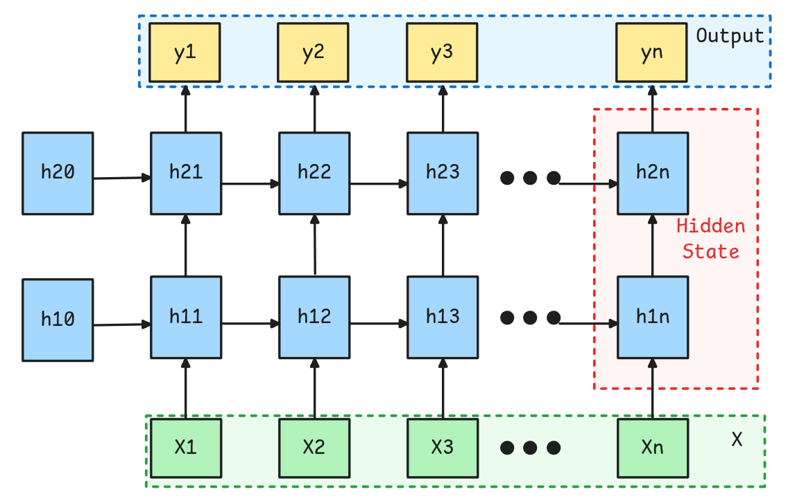{.lightbox fig-align="center"} 
:::
::: {.column}
::: {.callout-tip}
Es posible juntar varias capas recurrentes, para que las salidas de una alimenten un siguiente Hidden State, y que luego de algunas capas efectivamente se llegue a las salidas de interés.

Debido a que hacer esto es complicado esto viene integrado en la implementación en Pytorch mediante el parámetro `num_layers`.
:::

::: {.callout-warning appearance="default"}
## OJO
No existen salidas intermedias, sino que los Hidden States de capas anteriores son utilizados directamente como inputs de los hidden states posteriores.

En Pytorch los Hidden States se devuelven concatenados. Es común utilizar el último Hidden State, es decir, la última salida de la última capa como Input Features para una capa Fully Connected.
:::

::: {.callout-caution}
A diferencia de otro tipos de Redes como las Convolucionales o FFN, la profundidad en este tipo de redes es de bastante menos impacto.
:::

:::
::: 

## Variantes de RNNs: LSTM (1997){.smaller}

LSTM (Long Short-Term Memory)
: Es un tipo de Red Neuronal Recurrente que está diseñada para capturar dependencias de largo plazo abordando algunas de las limitaciones de las RNNs tradicionales, tales como el `vanishing gradient problem`.

::: {.columns}
::: {.column}
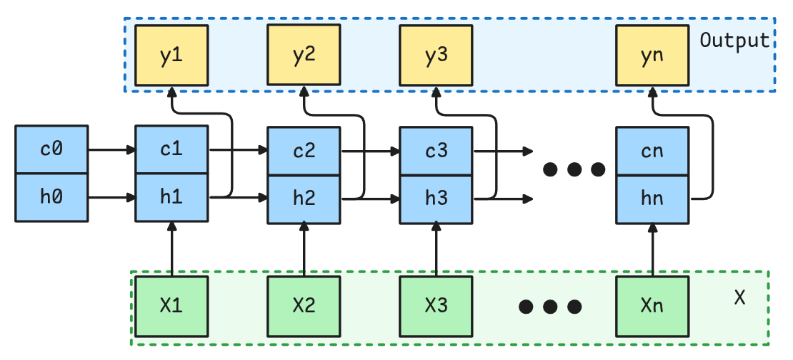{.lightbox fig-align="center"} 
:::
::: {.column}
::: {.callout-tip}
Posee un funcionamiento similar a la RNN, sólo que el "hidden state" se divide en dos partes: $h_t$ y $C_t$, llamados `hidden state` (corto plazo) y `cell state` (largo plazo) respectivamente.
:::

:::
::: 

::: {.callout-warning}
**Spoiler**: El Hidden y Cell State está compuesto por multiples set de parámetros a los cuales se les dan los nombres de `forget gate`, `input gate`, `cell gate` y `output gate`. Su interpretabilidad nunca ha logrado ser completamente explicada.
:::


## Variantes de RNNs: LSTM (1997){.smaller}


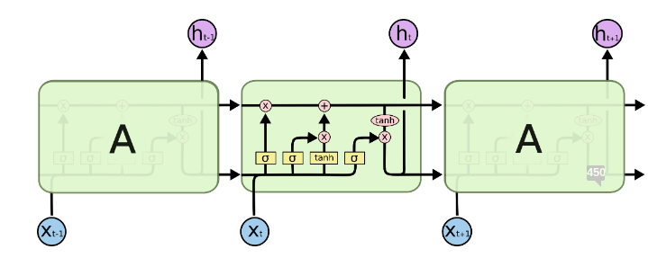{.lightbox fig-align="center"} 

::: {.columns}
::: {.column style="font-size: 80%;"}
* La LSTM está regida por las siguientes ecuaciones:

* $$i_t = \sigma(W_{ii}x_t + b_{ii} + W_{hi}h_{t-1} + b_{hi})$$
* $$f_t = \sigma(W_{if}x_t + b_{if} + W_{hf}h_{t-1} + b_{hf})$$
* $$g_t = tanh(W_{ig}x_t + b_{ig} + W_{hg}h_{t-1} + b_{hg})$$
* $$o_t = \sigma(W_{io}x_t + b_{io} + W_{ho}h_{t-1} + b_{ho})$$ 
* $$c_t = f_t \odot c_{t-1} + i_t \odot g_t$$
* $$h_t = o_t \odot tanh(c_t)$$
:::
::: {.column}
::: {.callout-important}
Todas estos elementos $i_t,f_t, g_t,o_t, c_t,h_t \in \mathbb{R}^d$, donde $d$ es el "hidden_size".
:::
:::
::: 

## LSTM: Forget Gate 


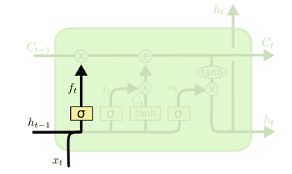{.lightbox fig-align="center" width="40%"} 

::: {.callout-caution appearance="default" icon="false" style="font-size: 85%;"}
## Forget Gate
* Corresponde a una red neuronal que indica qué informacion debe ser descartada del `Cell State`.
* Básicamente combina la secuencia en el tiempo t y el hidden state anterior.
* Luego se le aplica una Sigmoide que indicará el `porcentaje` a olvidar.

$$f_t = \sigma(W_{if}x_t + b_{if} + W_{hf}h_{t-1} + b_{hf})$$
:::


## LSTM: Input y Cell Gate 

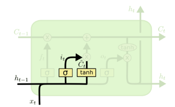{.lightbox fig-align="center" width="30%"} 

::: {.callout-tip appearance="default" icon="false" style="font-size: 70%;"}

## Input Gate
* Controla Cuánta información debe ingresar al `Cell State`.

$$i_t = \sigma(W_{ii}x_t + b_{ii} + W_{hi}h_{t-1} + b_{hi})$$
:::


::: {.callout-note appearance="default" icon="false" style="font-size: 70%"}
## Cell Gate
* Representa los potenciales nuevos candidatos a entrar al `Cell State`.

$$g_t = tanh(W_{ig}x_t + b_{ig} + W_{hg}h_{t-1} + b_{hg})$$
:::

## Output Gate y Hidden State

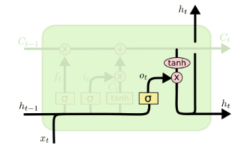{.lightbox fig-align="center" width="30%"} 

::: {.callout-important appearance="default" icon="false" style="font-size: 70%;"}
## Output Gate
* Determina qué "porcentaje" de información del "Cell State" debe salir como "Hidden State" para el tiempo $t$ actual.

* $$o_t = \sigma(W_{io}x_t + b_{io} + W_{ho}h_{t-1} + b_{ho})$$ 
:::

::: {.callout-warning appearance="default" icon="false" style="font-size: 70%;"}
## Hidden State
* Corresponde a las dependencias del tiempo anterior que se van traspasando en cada time step.
* Adicionalmente el Hidden State corresponde a la salida de la red para el tiempo $t$.

$$h_t = o_t \odot tanh(c_t)$$
:::


## Cell State

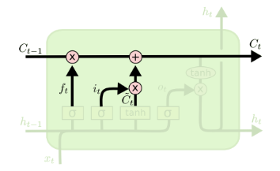{.lightbox fig-align="center" width="40%"} 

::: {.callout appearance="default" icon="false" style="font-size: 90%;"}

## Cell State

Representa la principal innovación de este tipo de redes ya que permite recordar dependencias de largo plazo (es decir time steps anteriores en secuencias largas). Esto ya que el Cell State puede avanzar casi sin interacciones lineales (no hay parámetros que influyen en ella, por lo que no es afectada por problemas de gradientes).

$$c_t = f_t \odot c_{t-1} + i_t \odot g_t$$
:::


## Variantes de RNNs: GRU (2014){.smaller}

GRU (Gated Recurrent Unit)
: Corresponde a otro tipo de Arquitectura Recurrente, similar a la LSTM, pero con una estructura más simplificada en la cuál se mantiene sólo un "Hidden State" y se tienen menos gates.

::: {.columns}
::: {.column}
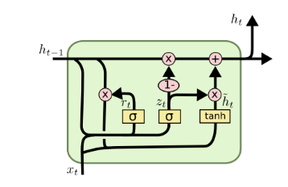{.lightbox fig-align="center" width="80%"} 

::: {.callout-caution appearance="default" icon="false"}
## Hidden State

Representa la potencial actualización del "Hidden State".

$$h_t = (1-z_t) \odot n_t + z_t \odot h_{t-1}$$
:::
:::
::: {.column}

::: {.callout-important appearance="default" icon="false"}
## Reset Gate

Controla cuánta información del pasado se debe olvidar. 

$$r_t = \sigma(W_{ir} x_t + b_{ir} + W_{hr}h_{t-1} + b_{hr})$$
:::

::: {.callout-note appearance="default" icon="false"}
##  Candidate Hidden State

Representa la potencial actualización del "Hidden State".

$$n_t = tanh(W_{in} x_t + b_{in} + r_t \odot (W_{hn} h_{t-1} + b_{hn}))$$
:::

::: {.callout-tip appearance="default" icon="false"}
## Update Gate

Controla qué porcentaje del "hidden state" previo se lleva al siguiente paso.

$$z_t = \sigma(W_{iz} x_t + b_{iz} + W_{hz}h_{t-1} + b_{hz})$$
:::
:::
::: 

## Bidirectional RNNs {.smaller}

Existen ocasiones en las que se requiere no sólo el contexto de los tiempos anteriores, sino también de los posteriores. Por ejemplo, problemas de traducción.

> Para ello existen las redes bidireccionales, en la cual se agrega una segunda capa pero que mueve los hidden state en el otro sentido.

::: {.columns}
::: {.column}
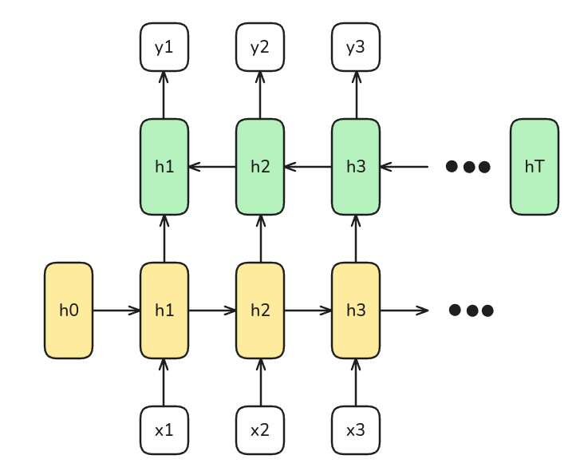{.lightbox fig-align="center" width="80%"}  
:::
::: {.column}
::: {.callout-note}
* En este caso la capa amarilla será la encargada de detectar dependencias del pasado.
* Mientras que la capa verde será la encargada de traer dependencias desde el futuro.
:::

::: {.callout-important}
Los hidden states pueden ser capas Vanilla RNN, LSTM o GRUs.
:::
:::
::: 

## Pytorch Layers 

```{.python}
nn.RNN(input_size, hidden_size, num_layers=1, batch_first=False, 
        dropout=0, bidirectional=False, nonlinearity="tanh")
```
```{.python}
nn.LSTM(input_size, hidden_size, num_layers=1, batch_first=False, 
        dropout=0, bidirectional=False) 
```

```{.python}
nn.GRU(input_size, hidden_size, num_layers=1, batch_first=False, 
        dropout=0, bidirectional=False) 
```
:::{style="font-size: 60%;"}

* **input_size**: Corresponde al número de features de la secuencia. 
* **hidden_size**: Corresponde al número de dimensiones del hidden state.
* **num_layers**: Corresponderá al número de capas recurrentes a apilar, por defecto 1.
* **batch_first**: Este siempre deben fijarlo como True, de esa manera se espera que los tensores a recibir siempre tengan el batch como primera dimensión. Por defecto False.
    * Luego RNNs esperan tensores de tamaño $(N,L,H_{in})$. Donde $N$ es el batch_size, $L$ es el largo de secuencia y $H_in$ es el `input_size`.
* **dropout**: Cantidad de dropout a aplicar a la salida de cada capa, excepto la última. Por defecto 0.
* **bidirectional**: Indica si se hace la red Bidireccional o no. Por defecto `False`.
* **nonlinearity**: Función de activación a utilizar para activar cada matriz de peso. Puede ser ***"tanh"*** o ***"relu"***. Sólo para Vanilla RNN.
:::


# Eso sería por hoy 😊

::: {.footer}
<p xmlns:cc="http://creativecommons.org/ns#" xmlns:dct="http://purl.org/dc/terms/"><span property="dct:title">Tics-579 Deep Learning</span> por Alfonso Tobar-Arancibia está licenciado bajo <a href="http://creativecommons.org/licenses/by-nc-sa/4.0/?ref=chooser-v1" target="_blank" rel="license noopener noreferrer" style="display:inline-block;">CC BY-NC-SA 4.0

</a></p>
:::
